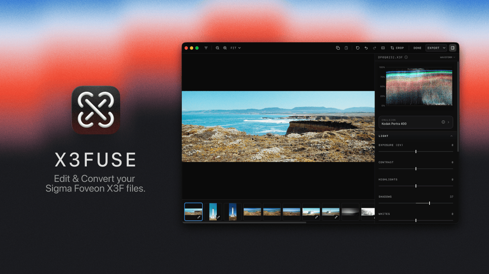

# X3Fuse

A cross-platform app for converting and editing Sigma classic, Merrill, and Quattro X3F RAW files.



## Overview

X3Fuse converts Sigma X3F files to DNG and TIFF and extracts embedded JPEG previews when available. Supported cameras include the classic SD9, SD10, and SD14, plus the Merrill and Quattro generations. You can use the converted files in editors that support these formats. The RAW editor also renders saved adjustments to JPEG or 16-bit TIFF. macOS is the released platform; Windows and Linux builds are available as alphas.

## Features

- **Multiple Output Formats**: Convert X3F files to DNG, TIFF, or JPEG formats
- **Batch Processing**: Process multiple files at once with an intuitive queue system
- **Cross-platform App**: Built with Tauri 2, React, and Rust
- **RAW Editor**: Adjust light, white balance, curves, HSL, crop, denoise, and sharpening, with the spektrafilm film model
- **Culling**: Pick or reject photos, assign star ratings, and filter the queue
- **EXIF Data Preservation**: Attempts to preserve metadata like preferred aspect ratio
- **Broad DNG Compatibility**: Merrill and Quattro DNGs are tested with Adobe, LibRaw, and Apple RAW-based workflows
- **Multi-language Support**: Available in English, Spanish, Japanese, Korean, Simplified Chinese, and Traditional Chinese\*
- **Drag & Drop Interface**: Simple file management with drag and drop support
- **Conversion Settings**: Customizable output options for your workflow

<sub>\*Don't see your language? Help us translate! See [Contributing](#contributing) below.</sub>

## Supported Cameras

X3Fuse supports X3F files from the following Sigma cameras.

| Camera Model | Tested | Untested | Notes |
| ---------------------- | ------ | -------- | ----- |
| **Classic Generation** |  |  |  |
| Sigma SD9 |  | ✅ | DNG and TIFF; no embedded JPEG |
| Sigma SD10 |  | ✅ | DNG and TIFF; no embedded JPEG |
| Sigma SD14 |  | ✅ | DNG, TIFF, and embedded JPEG |
| **Merrill Generation** |  |  |  |
| Sigma DP1 Merrill | ✅ |  |  |
| Sigma DP2 Merrill | ✅ |  |  |
| Sigma DP3 Merrill | ✅ |  |  |
| Sigma SD1 Merrill | ✅ |  |  |
| **Quattro Generation** |  |  |  |
| Sigma DP0 Quattro | ✅ |  |  |
| Sigma DP1 Quattro | ✅ |  |  |
| Sigma DP2 Quattro | ✅ |  |  |
| Sigma DP3 Quattro | ✅ |  |  |
| Sigma SD Quattro | ✅ |  |  |
| Sigma SD Quattro H | ✅ |  |  |

Classic Foveon support comes from x3f-core 0.3.0 and has not yet been verified in this app.
If your camera is not listed, please open an issue with a sample X3F.

## System Requirements

- **macOS release**: macOS 14.0 (Sonoma) or later, Intel or Apple Silicon.
- **Windows alpha**: x64, with Microsoft WebView2 Runtime.
- **Linux alpha**: x64, with WebKitGTK 4.1, GTK 3, and Perl.
- **RAW editor**: Metal on macOS, DirectX 12 on Windows, or Vulkan on Linux.
  Original conversion can run without a GPU.

## Installation

### Option 1: Download Release

Download `X3Fuse-App.zip` from the [Releases](https://github.com/sagwaco/x3fuse/releases)
page. Extract it, move `X3Fuse.app` to Applications, and open it. The macOS release
is universal, Developer ID signed, and notarized by Apple.

Windows and Linux portable alpha ZIPs are on the same Releases page. Extract the
ZIP for your OS and keep its executable and resources together. These builds are
unsigned. See [Alpha releases](#alpha-releases) for archive names and launch paths.

### Option 2: Homebrew

```bash
brew install --cask sagwaco/tap/x3fuse
```

Upgrade with `brew upgrade --cask x3fuse`, or use the app's update check on macOS.

### Option 3: Build from Source

Install the [development prerequisites](#prerequisites), then run:

```sh
git clone https://github.com/sagwaco/x3fuse.git
cd x3fuse
npm ci && npm run dev
```

Resource preparation downloads checksum-verified ExifTool 13.59 for the host OS.
You do not need a separate ExifTool installation or a sibling core checkout.

## Usage

1. Open X3Fuse. Drag X3F files onto the window, or add files from the File menu.
2. Browse the queue in list, grid, or filmstrip view. Use flags and ratings to cull photos.
3. To edit a photo, select it and choose **Edit**. Adjustments save automatically.
4. Choose **Export all** or **Export selected**. Review the output format, folder,
   and settings. Use original DNG/TIFF or Embedded JPG for conversion, or rendered
   JPEG/TIFF to include edits.
5. Click **Export** and monitor progress. Review any overwrite confirmation before
   replacing existing output files.

For DNG and TIFF, Settings provides NLM and BM3D denoising, separate luminance and color
noise controls, and the existing intensity slider. Advanced denoise settings provide a
strength multiplier, NLM patch and search sizes in pixels, and Automatic, CPU, or GPU
processing. Automatic uses the GPU when available and falls back to the CPU. Forced GPU
processing stops conversion if acceleration is unavailable. BM3D ignores NLM window sizes
and can take longer than NLM.

Version 0.2.0 replaces the SwiftUI app. Its settings are reset once; select your output
directory, format, and denoise preferences again. New settings use the core defaults: NLM,
color noise reduction on, luminance noise reduction off, strength 1.0, patch size 3,
search size 11, and Automatic processing. Denoised output can differ from earlier releases.

The conversion settings also include:

- **Color mode (experimental)**, for TIFF output with a color profile and Cineon off:
  applies a Sigma camera color mode, or the mode recorded in the file, to Merrill
  and dp Quattro files. Sunset Red, Forest Green, FOV Classic Yellow, Cinema, and
  Teal and Orange are dp Quattro only. The look is applied to the TIFF pixels.
- **Merrill highlight recovery**, for DNG output: enables highlight recovery during conversion.

### Converting a classic-camera library

Keep the original X3F files as your archive. A DNG contains converted image data, not a
complete copy of the X3F. Conversion applies camera calibration and any selected noise
reduction. You cannot undo these steps in the DNG or recover all Sigma Photo Pro settings.

| Goal | Output and settings |
| ---- | ------------------- |
| Continue editing exposure and white balance | DNG. Enable RAW compression to reduce its size. |
| Apply noise reduction in the destination editor | DNG with Denoise intensity set to Off. |
| Apply X3Fuse noise reduction during conversion | DNG or TIFF. Start with the defaults and compare a few images at full size. |
| Save a rendered image for editors without DNG support | 16-bit TIFF. Choose a color profile and enable compression if the editor supports it. |
| Extract the camera preview | Embedded JPG, when present. SD9 and SD10 files have no embedded JPEG. |

DNG uses lossless compression of the converted pixels. It does not make the conversion
reversible or guarantee a file smaller than the X3F. TIFF also supports lossless compression,
but stores rendered RGB data and can be much larger. Embedded JPG extracts an existing
preview; it does not render a new JPEG with your conversion settings.

These historical sample sizes use default noise reduction on the CPU, before additional
EXIF tags are copied. They do not verify classic-camera conversion in this app. Sizes are
rounded decimal MB. Results depend on the image and settings.

| Sample | Original X3F | DNG | Compressed DNG |
| ------ | -----------: | --: | -------------: |
| [SD9](https://raw.pixls.us/getfile.php/700/nice/Sigma%20-%20Sigma%20SD9.X3F) | 7.4 MB | 20.7 MB | 12.5 MB |
| [SD10](https://raw.pixls.us/getfile.php/571/nice/Sigma%20-%20Sigma%20SD10.X3F) | 8.1 MB | 20.7 MB | 14.0 MB |
| [SD14](https://raw.pixls.us/getfile.php/4462/nice/Sigma%20-%20SIGMA%20SD14%20-%203:2.X3F) | 12.2 MB | 28.1 MB | 17.6 MB |

Noise reduction is saved in the output pixels. Stronger settings can remove fine detail.
For future noise-reduction work, retain the X3F and compare an undenoised DNG with a denoised
copy. X3Fuse uses its own NLM or BM3D processing; it does not reproduce Sigma Photo Pro's
noise reduction or saved edits. Leave Merrill highlight recovery off when starting with
classic files. No classic-camera flat-field opcode files are bundled.

Convert a small batch first. Check color, highlights, fine detail, metadata, and file size in
your destination editor before converting the library. The editor compatibility results
below apply to Merrill and Quattro files; classic DNGs still need checks in each editor.

## DNG Compatibility

X3Fuse creates DNGs that are designed to work across common RAW decoding engines, not only Adobe Camera Raw. Merrill and Quattro files, including DNGs created with **RAW compression** and/or **Merrill highlight recovery** enabled, have been tested successfully in:

- Adobe Lightroom and Adobe Photoshop
- Darktable
- RawTherapee
- RapidRAW
- Pixelmator and Photomator
- Preview on macOS

Foveon cameras do not have a color filter array (CFA) like most other cameras, so some RAW applications may still have Foveon-specific rendering differences. If you encounter an issue with a particular editor, please open a GitHub issue with the camera model, conversion settings, and target application.

## Known Issues

#### X3I files not supported

X3I files generated in Quattro Super fine detail (SFD) mode are not supported. A workaround is to shoot several exposure bracketed images as X3Fs and then use X3Fuse to convert them to DNG. In a photo editing application like Lightroom, you can then merge the DNG files into an HDR image.

The RAW editor requires a supported GPU. Film rendering is experimental, and
Windows/Linux builds need runtime testing on their target systems. Culling flags
and ratings are stored by file path; moving a photo does not carry them with it.

## Technical Details

X3Fuse 0.2.0 uses Tauri 2 with a React renderer and a Rust backend. Its bundle
identifier is `com.sagwa.X3Fuse`.

- [**x3f-core 0.3.0**](https://github.com/sagwaco/x3fuse-core): published on crates.io;
  converts X3F files and prepares RAW data directly in Rust.
- **x3f-render**: in-repo GPU renderer for RAW edits and the spektrafilm film model.
- [**ExifTool 13.59**](https://github.com/exiftool/exiftool): bundled metadata handling.
- **tauri-plugin-updater**: macOS updates from `docs/Support/latest.json`.
  Windows and Linux portable alphas have no updater.

## Acknowledgements

[x3fuse-core](https://github.com/sagwaco/x3fuse-core), which powers the x3f processing in x3fuse is based on [x3f_tools](https://github.com/Kalpanika/x3f). This project is not affiliated with nor endorsed by the creators of x3f_tools.

Film simulation uses [spektrafilm](https://github.com/andreavolpato/spektrafilm) by
Andrea Volpato, ported from spektrafilm-rs (GPL-3.0). Profiles and data are CC BY-SA 4.0.

## License

X3Fuse is licensed under [GPL-3.0-only](LICENSE). Open **Settings -> About -> View Licenses** for bundled third-party notices.

This project is not affiliated nor endorsed by Sigma Corporation. Sigma and Foveon are trademarks of Sigma Corporation.

## Contributing

Contributions are welcome! Please feel free to submit a [Pull Request](https://docs.github.com/en/pull-requests/collaborating-with-pull-requests/proposing-changes-to-your-work-with-pull-requests/creating-a-pull-request).

## Support

If you encounter any issues or have questions:

- Open an issue on [GitHub Issues](https://github.com/sagwaco/x3fuse/issues)
- Check the [Releases](https://github.com/sagwaco/x3fuse/releases) page for updates

## Privacy

X3Fuse processes photos locally. Photos are not uploaded. On macOS, update checks
contact the update feed and downloads come from GitHub Releases.

## Development

### Prerequisites

Install Node.js 22 LTS, stable Rust, and the
[Tauri prerequisites](https://v2.tauri.app/start/prerequisites/) for your OS:

- macOS 14 or newer: Xcode command-line tools and system Perl.
- Windows x64: Visual Studio C++ build tools, LLVM/libclang, and WebView2 Runtime.
  Set `LIBCLANG_PATH` to LLVM's `bin` directory if it is not found automatically.
- Linux x64: GTK 3, WebKitGTK 4.1 development packages, build tools, Clang/libclang,
  Perl, and `zip`/`unzip` for packaging and archive tests.

Run commands from the repository root. `npm run dev` prepares resources and starts
Tauri with Vite hot reload. ExifTool and license notices are generated under
`src-tauri/resources/`; opcode data is tracked in `src-tauri/resources/opcodes/`.
Windows bundles the complete ExifTool standalone runtime. macOS and Linux use its
Perl script and modules. `npm run sync:resources` includes renderer license and
spectral-data notices in the app.

Both the backend and `src-tauri/crates/x3f-render` use published `x3f-core` 0.3.0.
`src-tauri/Cargo.lock` pins dependency versions. To test an unpublished core, use a
temporary `[patch.crates-io]` for `x3f-core` and `x3f-sys`. Never commit this patch
or its local-path lockfile changes; CI cannot access local checkouts.

Development builds optimize RAW processing, rendering, PNG encoding, and TIFF
compression. Original conversion uses GPU denoising when available and can fall
back to CPU. The editor requires a supported GPU.

### Checks and builds

```sh
npm run sync:resources
npm run typecheck
npm run lint
npm test
npm run build:frontend
cargo fmt --manifest-path src-tauri/Cargo.toml -- --check
cargo clippy --manifest-path src-tauri/Cargo.toml --locked --workspace --all-targets -- -D warnings
cargo test --manifest-path src-tauri/Cargo.toml --locked --workspace
```

Frontend tests cover browsing, scopes, zoom, import, batches, Tauri commands and
events, native-menu lifecycle, drag/drop, and artifact layout. Rust tests cover
backend behavior. Unit tests alone do not verify real-file conversion or native
webview behavior.

Real conversion acceptance needs Merrill and Quattro files at absolute paths:

```sh
X3FUSE_TEST_MERRILL=/absolute/path/merrill.X3F \
X3FUSE_TEST_QUATTRO=/absolute/path/quattro.X3F \
cargo test --manifest-path src-tauri/Cargo.toml --locked --test conversion_acceptance -- --ignored
```

This checks full-strength denoising with compressed DNG/TIFF and DNG highlight
recovery, with a 60-second limit per conversion. Use the default test profile to
check development-build performance too.

Build a macOS app bundle with `npm run dist`, or a native executable with
`npm run pack`. Windows/Linux currently use the executable build. Package it with:

```sh
node scripts/package-artifact.mjs
```

The ZIP in `artifacts/` contains the application and its resources:

| Platform | Extracted layout | Launch |
| -------- | ---------------- | ------ |
| macOS | `X3Fuse.app`, with resources inside | Open the app |
| Windows | `x3fuse-tauri.exe` beside `resources/` | Run the executable |
| Linux | `bin/x3fuse-tauri` and `lib/x3fuse-tauri/resources/` | Run `./bin/x3fuse-tauri` |

Keep the complete extracted directory together. These artifacts need the platform
webview runtime and, on macOS/Linux, Perl. They do not need a source checkout.
Branch, pull-request, and manual CI runs upload Actions artifacts; their macOS
builds do not use Developer ID signing or notarization credentials.

### Alpha releases

Tags matching `x3fuse-alpha-<version>-<sequence>` run the four-platform checks and
builds, then publish a GitHub prerelease after all jobs succeed. A new commit
needs a new alpha tag; reruns update assets on the same prerelease. Alpha tags do
not replace the stable latest release or change the app's internal version.

Download from the [Releases](https://github.com/sagwaco/x3fuse/releases) page:

- `x3fuse-alpha-macos-arm64.zip`: Apple Silicon Mac.
- `x3fuse-alpha-macos-x64.zip`: Intel Mac.
- `x3fuse-alpha-windows-x64.zip`: Windows x64.
- `x3fuse-alpha-linux-x64.zip`: Linux x64.

macOS alpha releases are Developer ID signed and notarized. Windows and Linux
builds are unsigned portable ZIPs with no automatic updater. Follow the launch
table above or the included `README.txt`. Report the alpha tag and OS with results.

Stable macOS releases start with a `/release` PR comment. The workflow builds a
universal signed and notarized app, publishes `X3Fuse-App.zip`,
`X3Fuse.app.tar.gz`, and `X3Fuse.app.tar.gz.sig`, writes `docs/Support/latest.json`,
and bumps the Homebrew cask. The Sparkle setup, appcast generation, and note
injection steps run only for 0.2.0. They write `docs/Support/appcast.xml` once more
for the bridge from older installations; it stays frozen afterwards. Later
updates use `tauri-plugin-updater`. Release notes use `# <version> - <title>`
followed by `-` bullets in `Release_Notes.md`.

### Runtime acceptance

The opt-in native probe runs bundled assets under the production CSP in the real
webview, without screen-capture permission:

```sh
X3FUSE_SMOKE_FILE=/absolute/path/sample.X3F npm run test:native -- --build
```

It checks import, previews, workers, delayed full-resolution decoding, a 1,000-row
synthetic filmstrip, navigation, scopes, and native resizing. The synthetic rows
reuse one file; this does not measure extraction from 1,000 distinct photos.
macOS also checks intermediate window geometry during zoom and restore.

The standalone macOS zoom regression check needs no X3F input:

```sh
xcrun clang -fobjc-arc -mmacosx-version-min=14.0 -framework AppKit -framework WebKit \
  -framework QuartzCore tests/native-zoom.m -o /tmp/x3fuse-native-zoom
/tmp/x3fuse-native-zoom
```

`--build` creates a Debug executable with the probe enabled. Omit it to reuse
that executable. The probe is absent from release builds, needs a desktop session,
and exits within 100 seconds after building. Reports go to
`artifacts/native-smoke-<platform>.json`; use `X3FUSE_SMOKE_REPORT` to override it.
Repeat with Merrill and Quattro files.

Run each extracted artifact outside the repository on its target OS. Check native
import and drops, list/grid/filmstrip views, portrait and cropped previews, scopes,
pinch and keyboard zoom, Settings, native menu selection and dismissal, output
reveal, and persistence after relaunch. Export Merrill and Quattro files in all
three formats. Check cancellation, invalid inputs, overwrite confirmation,
parallel batches, and preservation of pre-existing outputs after failure.
Check actual painting during macOS titlebar zoom in populated views. DOM geometry
checks alone do not establish smooth painting. Native popup selection remains a
manual check. Unit tests do not exercise WKWebView, WebView2, or WebKitGTK.

### RAW editor notes

Select a photo and choose **Edit**. The editor shares browsing's filmstrip,
zoom/pan, and scopes. It provides light, calibrated white balance, curves, HSL,
monochrome filters, crop/straighten, denoise, sharpening, and film controls.
Film rendering starts enabled. Exposure adjusts film exposure while it is enabled.
The spektrafilm model simulates negative response, DIR couplers, grain, halation,
and print paper. Existing film recipes load unchanged but render differently
from the model used in earlier alphas; no re-save is required.

The film picker includes an experimental **Aerochrome-style (Foveon)** look for
full spectrum captures with a physical filter. It uses the file's FOV Classic Blue
calibration and the Ektachrome 100 model. It approximates the look without
reconstructing a separate IR band or measured Aerochrome spectral response.
Files without FCBlue calibration cannot select this preset.

Double-click a slider thumb to restore its default. Grain and halation have
strength controls and advanced settings. New edits use the camera's as-shot crop.
Monochrome filters mix calibrated Foveon sensor-layer responses and remain gray
through color film and channel-curve processing.

Edits autosave to `<photo>.X3F.x3fuse.json`; the RAW stays unchanged. Move the
sidecar with the photo to carry its edits. Unwritable source folders use the
application-data `edits/` backup directory, and the app shows its location.
Invalid/newer recipes and source-content mismatches are reported without
overwriting files. Undo lasts for the app session; the final recipe persists.
Copy/Paste Adjustments excludes geometry and the grain seed. Pick/reject flags
and star ratings are separate, stored by path in app-data `culling.json`.

Editor and main-view exports share the review screen. Rendered JPEG and 16-bit
TIFF bake saved edits and carry sRGB, Adobe RGB, or ProPhoto RGB profiles with
normalized orientation. TIFF batches with edited photos default to rendered
mode; unedited photos in that batch use the default film recipe. Original DNG
and Embedded JPG remain separate options and do not bake edits.

NLM and BM3D controls are available in Detail and original-export settings.
Advanced controls separate luminance/chroma reduction, strength, and NLM window
sizes. NLM defaults to luminance off and chroma on. BM3D uses a fixed block profile
and ignores NLM window sizes. Both can use GPU acceleration with CPU fallback;
BM3D can take longer. Denoise options persist in preferences and photo recipes.
Changing sensor denoise invalidates prepared RAW data; slider gestures defer
preparation until release. Edited exports use the complete saved recipe.

Enable **Debug logging** in Settings and prepare an uncached RAW, or change its
denoise strength, to check for `NLM: gpu`, `BM3D: gpu`, or `Denoise stage:` in logs.
Cached previews can skip denoising. On macOS, settings and app data are under
`~/Library/Application Support/com.sagwa.X3Fuse`; logs are under
`~/Library/Logs/com.sagwa.X3Fuse`. Other platforms use Tauri's app config, data,
and log directories under the same identifier.

The backend validates RAW inputs, caches prepared data, serializes GPU work, and
renders bounded overlapping tiles. Interactive previews refine after input stops.
Zoomed requests render the viewport at native detail, capped at 4096 pixels.
Returning to Fit refreshes the full image. Scopes show the visible region.
Saved edits use bounded persistent thumbnail and medium-preview caches under
`edits/thumbnails-v1` and `edits/mediums-v1`. Initial uncached preparation can take
time. Rendering pauses during export. Driver/device failures are reported as
errors; they do not silently bypass film rendering.

GPU correctness and real-photo acceptance checks:

```sh
cargo test --manifest-path src-tauri/Cargo.toml -p x3f-render -- --include-ignored

X3FUSE_TEST_MERRILL=/absolute/path/merrill.X3F \
X3FUSE_TEST_QUATTRO=/absolute/path/quattro.X3F \
cargo test --manifest-path src-tauri/Cargo.toml --test editor_acceptance -- --ignored --nocapture

X3FUSE_TEST_EDITED_A=/absolute/path/edited-a.X3F \
X3FUSE_TEST_EDITED_B=/absolute/path/edited-b.X3F \
cargo test --manifest-path src-tauri/Cargo.toml --test edited_thumbnail_acceptance -- --ignored --nocapture
```

Editor acceptance verifies the input camera families and uses temporary copies.
Edited-thumbnail tests need adjacent `.x3fuse.json` sidecars and check progressive
renders, denoised refinement, concurrent cancellation, and cached pixels after restart.
Cross-platform compilation alone does not establish GPU driver behavior.

The native editor probe opens Edit, checks default film and as-shot crop,
measures slider input through canvas paint, checks reset, refinement, undo/redo,
sidecar reload, monochrome pixels, viewport rendering, Fit, JPEG export, and main
export review with saved edits:

```sh
X3FUSE_EDITOR_SMOKE=1 X3FUSE_SMOKE_FILE=/absolute/path/photo.X3F \
npm run test:native -- --build
```

This probe copies the input to temporary storage and removes generated edits and
exports. It ignores the remembered export destination. Keep the window visible
for paint measurements. Repeat with each camera family. Native editor probes
need a desktop session and a supported GPU. Rebuild after a direct Cargo run,
which can replace the probe executable with a development-server build.
